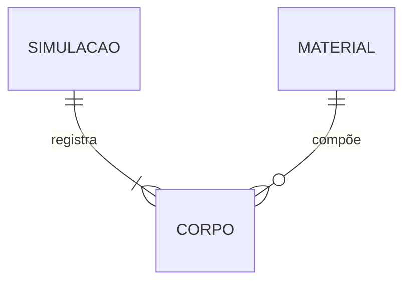
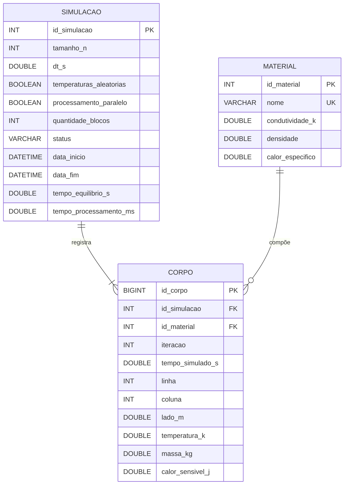

# Simulador de Troca de Calor — Computação Paralela e Banco de Dados

Dupla: João Vitor Moraes & André Dalvi

## 1. Como rodar

1. Crie o banco executando `banco/simulador_calor.sql` uma única vez no MySQL (Workbench, phpMyAdmin ou `mysql -u root -p < banco/simulador_calor.sql`).
2. Ajuste usuário e senha em `SimuladorCalor/ConfiguracaoBanco.cs`.
3. Abra a solução no Visual Studio. O pacote **MySqlConnector** já está no `.csproj` e é baixado no primeiro build.
4. Clique em **Criar Matriz** e depois em **Iniciar**. A gravação no banco começa no Iniciar.

Controles do painel lateral (role para baixo para vê-los):
- **Paralelo em blocos (Invoke)**: ligado usa `Parallel.Invoke`; desligado executa os mesmos blocos um depois do outro. Fica travado enquanto uma simulação está sendo gravada.
- **Gravar no banco MySQL**.
- Painel de status com o modo, a grade de blocos, os milissegundos por tick e o andamento da gravação.

A matriz agora vai até **200×200** (40.000 cubos). Quando os cubos ficam pequenos demais, a temperatura não é escrita dentro deles e a grade é desenhada como imagem, com um pixel por cubo ampliado.

## 2. Computação paralela: decomposição em blocos

### Ideia
O problema grande (todos os cubos trocando calor) é quebrado em **blocos menores, um por núcleo do processador**. Cada bloco resolve as trocas internas em paralelo; depois são resolvidas as trocas entre blocos vizinhos (a fronteira). A técnica se chama **decomposição de domínio**.

### Formato da grade de blocos
O programa lê `Environment.ProcessorCount` e escolhe a grade de blocos mais próxima de um quadrado, porque blocos quadrados têm menos fronteira:

| Núcleos | Grade de blocos | Matriz 200×200 vira blocos de |
|---|---|---|
| 4 | 2×2 | 100×100 |
| 6 | 2×3 | 100×66 (ou 67) |
| 8 | 2×4 | 100×50 |
| 12 | 3×4 | 66 (ou 67)×50 |
| 16 | 4×4 | 50×50 |

Em matrizes pequenas, a grade é limitada ao tamanho da matriz (uma matriz 2×2 nunca tem mais de 2×2 blocos).

### As três fases de cada passo

```
+---------+---------+
| bloco 0 | bloco 1 |      FASE 1 (paralela, Parallel.Invoke):
|         |         |        cada bloco calcula os pares INTERNOS
+---------+---------+  <-  FASE 2 (sequencial):
| bloco 2 | bloco 3 |        pares que cruzam a fronteira
|         |         |      FASE 3 (paralela, Parallel.Invoke):
+---------+---------+        cada bloco aplica a energia nos seus cubos
```

1. **Pares internos (paralelo).** Cada bloco percorre seus cubos com o mesmo algoritmo de pares da versão original (`energia[a] -= e; energia[b] += e`). Como os dois cubos de um par interno estão no mesmo bloco, cada thread escreve apenas na sua parte da matriz `energia`, então **não há condição de corrida** e não é preciso `lock`.
2. **Pares de fronteira (sequencial).** Os pares com um cubo de cada lado de um corte são calculados depois que todos os blocos terminaram. São pouquíssimos: numa matriz 200×200 com grade 2×4, são 800 de 79.600 pares (cerca de 1%).
3. **Aplicar a energia (paralelo).** Cada bloco aplica a energia acumulada nos seus cubos. As temperaturas só mudam aqui; até então, todos os cálculos usaram as temperaturas do início do passo, exatamente como no algoritmo original.

O `Parallel.Invoke` só retorna quando **todas** as `Action`s terminam. Por isso ele funciona como **barreira** entre as fases: a fronteira nunca é calculada com um bloco ainda trabalhando.

Observação: o `Parallel.Invoke` entrega as `Action`s ao agendador do .NET e ao sistema operacional, que escolhem os núcleos. Com núcleos livres, os blocos rodam ao mesmo tempo em núcleos diferentes, mas o C# não "prende" um bloco a um núcleo específico.

### Validação
- Com 1, 4, 6 e 8 núcleos e matrizes de 2×2 a 200×200, o resultado paralelo foi **idêntico bit a bit** ao sequencial.
- Comparado ao algoritmo original da dupla, a diferença máxima foi de 6×10⁻¹⁴ K, só arredondamento por somar na ordem diferente. Nas matrizes pequenas, o resultado foi exatamente igual.
- O calor total variou menos de 10⁻¹⁴ (relativo): a energia se conserva.

### Cálculo em segundo plano
Com matrizes grandes, um tick pode levar segundos. Se os passos rodassem na thread da tela, a janela congelaria. Por isso o `timer1_Tick` é `async` e roda os passos com `await Task.Run(...)`. Enquanto calcula:
- novos ticks são ignorados (o próximo só começa quando o atual termina);
- o botão **Aplicar no cubo** fica desabilitado, porque editar um cubo enquanto outra thread altera as temperaturas seria uma condição de corrida;
- se o usuário criar outra matriz ou fechar a janela, o resultado do cálculo em andamento é descartado.

### Gravação em segundo plano
O banco também roda numa thread própria (produtor/consumidor). A tela tira uma "foto" imutável dos cubos e a coloca numa fila; uma única thread lê a fila e grava no MySQL. Se o banco ficar mais lento que a simulação e a fila passar de 10 iterações, a simulação espera. **Nenhuma iteração é perdida.**

## 3. Banco de dados

Comandos SQL usados pelo programa: **INSERT, SELECT e UPDATE**. Nenhum DELETE, CASCADE, trigger ou view.

### O que é gravado
- **Iniciar:** `INSERT` de uma linha em `simulacao` e dos N² corpos da iteração 0 (estado inicial).
- **Cada tick:** `INSERT` dos N² corpos com o novo número de iteração, numa transação e em lotes de 1.000 linhas.
- **Edição de um cubo durante a simulação:** `INSERT` dos N² corpos como uma nova iteração com o **mesmo** tempo simulado.
- **Fim** (equilíbrio, nova matriz ou fechar o programa): `UPDATE` na `simulacao` com status, data de fim, tempo até o equilíbrio e tempo total de processamento.
- **Ao conectar:** `SELECT` dos materiais, para saber o `id_material` de cada um.

### Modelo conceitual (DER)



- Uma **SIMULAÇÃO** registra vários **CORPOS** (N² por iteração); cada registro de corpo pertence a uma simulação (1:N).
- Um **MATERIAL** compõe vários registros de corpo; cada registro tem exatamente um material (1:N).

### Modelo lógico



### Modelo relacional

```
MATERIAL (id_material, nome, condutividade_k, densidade, calor_especifico)
  PK: id_material
  UK: nome

SIMULACAO (id_simulacao, tamanho_n, dt_s, temperaturas_aleatorias,
           processamento_paralelo, quantidade_blocos, status, data_inicio,
           data_fim, tempo_equilibrio_s, tempo_processamento_ms)
  PK: id_simulacao

CORPO (id_corpo, id_simulacao, id_material, iteracao, tempo_simulado_s,
       linha, coluna, lado_m, temperatura_k, massa_kg, calor_sensivel_j)
  PK: id_corpo
  FK: id_simulacao → SIMULACAO
  FK: id_material  → MATERIAL
  Índice: (id_simulacao, iteracao)
```

### Dicionário de dados

**MATERIAL** — catálogo de materiais, cadastrado pelo script SQL.

| Coluna | Tipo | Restrições | Descrição |
|---|---|---|---|
| id_material | INT | PK, AUTO_INCREMENT | Identificador |
| nome | VARCHAR(50) | NOT NULL, UNIQUE | Nome do material |
| condutividade_k | DOUBLE | NOT NULL | Condutividade térmica, W/(m·K) |
| densidade | DOUBLE | NOT NULL | Densidade, kg/m³ |
| calor_especifico | DOUBLE | NOT NULL | Calor específico, J/(kg·K) |

**SIMULACAO** — uma linha por execução, do Iniciar até o fim.

| Coluna | Tipo | Restrições | Descrição |
|---|---|---|---|
| id_simulacao | INT | PK, AUTO_INCREMENT | Identificador |
| tamanho_n | INT | NOT NULL | Matriz N×N |
| dt_s | DOUBLE | NOT NULL | Duração de cada passo (s) |
| temperaturas_aleatorias | BOOLEAN | NOT NULL | Se a matriz foi criada com temperaturas aleatórias |
| processamento_paralelo | BOOLEAN | NOT NULL | Se usou `Parallel.Invoke` |
| quantidade_blocos | INT | NOT NULL | Em quantos blocos a matriz foi dividida |
| status | VARCHAR(20) | NOT NULL | EM_ANDAMENTO, EQUILIBRIO ou INTERROMPIDA |
| data_inicio | DATETIME | NOT NULL | Início |
| data_fim | DATETIME | NULL | Fim (preenchida por UPDATE) |
| tempo_equilibrio_s | DOUBLE | NULL | Tempo simulado até o equilíbrio; NULL se não chegou |
| tempo_processamento_ms | DOUBLE | NULL | Tempo real gasto nos cálculos (preenchido por UPDATE) |

**CORPO** — cada cubo em cada iteração.

| Coluna | Tipo | Restrições | Descrição |
|---|---|---|---|
| id_corpo | BIGINT | PK, AUTO_INCREMENT | Identificador do registro |
| id_simulacao | INT | FK, NOT NULL | Simulação |
| id_material | INT | FK, NOT NULL | Material naquele momento (pode mudar por edição) |
| iteracao | INT | NOT NULL | 0 = estado inicial, depois 1, 2, 3... |
| tempo_simulado_s | DOUBLE | NOT NULL | Tempo simulado naquela iteração |
| linha | INT | NOT NULL | Posição na matriz (começa em 0) |
| coluna | INT | NOT NULL | Posição na matriz (começa em 0) |
| lado_m | DOUBLE | NOT NULL | Aresta do cubo (m) |
| temperatura_k | DOUBLE | NOT NULL | Temperatura (K) |
| massa_kg | DOUBLE | NOT NULL | Massa (kg) |
| calor_sensivel_j | DOUBLE | NOT NULL | Calor sensível Q = m·c·T (J) |

### Por que cada decisão

- **Três tabelas.** Cada registro de `corpo` é o cubo num momento da simulação (identificado por `iteracao`). Isso atende ao requisito de gravar todas as informações de cada corpo em cada iteração com o menor número de tabelas.
- **Material em tabela separada.** Evita repetir nome e propriedades físicas em milhões de linhas e impede "dois cobres diferentes". O `UNIQUE` em `nome` impede cadastrar o mesmo material duas vezes.
- **Chaves estrangeiras sem CASCADE.** Garantem que todo corpo aponta para uma simulação e um material existentes, sem nenhum comando extra.
- **`BIGINT` em `id_corpo`.** Uma simulação 200×200 grava 40.000 linhas por tick; o limite do `INT` (2,1 bilhões) poderia ser atingido com o tempo.
- **Índice `(id_simulacao, iteracao)`.** O `SELECT` de remontagem filtra por essas duas colunas. Sem o índice, o MySQL leria a tabela inteira, que pode ter milhões de linhas. O teste confirmou que a consulta usa o índice.
- **`DOUBLE` nos valores físicos.** Guarda exatamente o mesmo valor do `double` do C#, e por isso a remontagem é idêntica bit a bit. `DECIMAL` arredondaria.
- **`massa_kg` e `calor_sensivel_j`.** Poderiam ser calculados, mas são gravados porque o requisito pede todas as informações de cada corpo. É uma redundância consciente.
- **Transação por iteração.** Ou a iteração inteira é gravada, ou nada: nunca fica uma iteração "pela metade".
- **Lotes de 1.000 linhas.** Um único `INSERT` com 40.000 linhas poderia passar do tamanho máximo de pacote do MySQL (`max_allowed_packet`). Mil linhas por comando é rápido e seguro.

### Como remontar a simulação

Matriz em qualquer iteração:

```sql
SELECT c.linha, c.coluna, m.nome AS material, c.lado_m, c.temperatura_k
FROM corpo c
JOIN material m ON m.id_material = c.id_material
WHERE c.id_simulacao = 1 AND c.iteracao = 10
ORDER BY c.linha, c.coluna;
```

Para reproduzir a evolução de uma iteração k para a k+1: carregue o estado k, calcule `passos = (tempo_simulado_s[k+1] − tempo_simulado_s[k]) / dt_s` e rode esse número de passos. Se `passos = 0`, a iteração k+1 foi uma edição do usuário. Testado: a remontagem a partir do banco reproduziu todas as iterações bit a bit, inclusive com uma edição no meio.

### Volume de dados

Cada iteração grava N² linhas (cerca de 120 bytes cada no MySQL). Numa matriz 200×200, são 40.000 linhas e uns 5 MB por tick. Para simulações longas, aumente a **Velocidade (passos por atualização)**: menos ticks significam menos linhas gravadas.

## 4. Limitações conhecidas

- As propriedades dos materiais existem no `Material.cs` e na tabela `material`. Se uma for alterada, a outra precisa ser alterada também.
- A tabela `corpo` repete `tempo_simulado_s` e `lado_m` em todas as linhas da mesma iteração. É o preço de usar só 3 tabelas.
- Quem garante que um cubo não aparece duas vezes na mesma iteração é o programa, não o banco.
- Em matrizes pequenas, o custo de coordenar as threads pode ser maior que o ganho. O paralelismo compensa conforme a matriz cresce. Para medir, rode a mesma matriz com e sem a opção paralela e compare a coluna `tempo_processamento_ms`.
